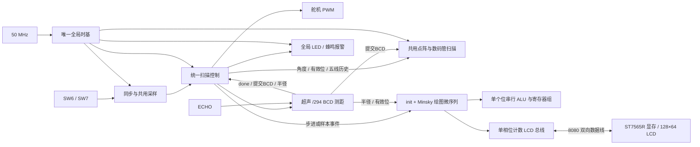

# 简易雷达与极坐标液晶系统审计报告

**资料截止：2026-10-15；对象：当前已烧录的 1089 LE 回读版本。**

本报告供接手开发、功能验收和资源优化分析使用。以当前 RTL、实际 Quartus 构建快照、仿真记录及烧录日志为证据；不修改设计、不重新编译或烧录，不把源码意图等同于实物验收。

## 1. 审计结论与当前状态

系统已实现一套扫描控制引擎，在同一 MAX II 配置映像中通过 SW6 选择基本分段扫描和连续扫描。它控制舵机、超声测距、八位数码管、双色点阵、16 个 LED、蜂鸣器和 ST7565R 液晶。液晶使用 Minsky 方向向量、位串行坐标累加和逐像素读改写，显示半圆距离圈及测量目标。

**当前整机实际布局结果为 1089/1270 LE、437 个寄存器、75/116 I/O、UFM 0/1；50 MHz 下 setup slack 3.786 ns、hold slack 1.078 ns，Fitter 成功。** 总资源低于优选上限 1143 LE，但测距和绘图两个分模块预算没有达标。

**回读版已经在用户明确确认电气安全后烧入开发板，Quartus 编程及校验成功。** 这证明映像写入成功；现有记录尚不能证明液晶实屏、舵机机械方向、真实测距、颜色及蜂鸣器效果全部通过上板验收。

当前最重要的功能限制是：基本模式 16 µs 内部步进快于绘图处理速度，无队列且忙时直接丢弃请求。已有仿真证明接受请求的绘图正确，但尚未证明这些丢弃后基本模式整圈的圈点和旧目标清除仍完整。

| 审计事项 | 当前结论 | 证据强度 |
|---|---|---|
| 单一映像、SW6 双模式、统一扫描引擎 | 已实现 | 源码及实际综合层级 |
| 整机 ≤1143 LE、50 MHz 已约束路径通过 | 已达到 | 最终 Fitter / TimeQuest 原始报告 |
| 测距误差 ≤2 mm | 数字换算误差最大 1.5966 mm | 理想换算穷举及 RTL 测试；不包含真实传感器误差 |
| 接受请求的极坐标绘图、读改写及换向 | 离线测试通过 | 375 请求、逐像素与整块显存比较 |
| 开发板编程、校验 | 已完成 | USB-Blaster / EPM1270 的 PV 日志 |
| 实物完整功能验收 | 尚未完成 | 未收到画面、机械或仪器测量结果 |
| 所有分模块预算 | 未全部满足 | 测距 137>120；绘图含 init 395>210 |
| 全板外部时序签核 | 未完成 | 仍有 1 个输入、58 个输出未完整约束 |

## 2. 背景、目标与约束演变

### 2.1 工程背景

仓库为 `SxGit-25/digital-logic-lab-2`，原始任务基线为 `4e858a8`。目标器件为 MAX II **EPM1270T144C5**，主时钟 **50 MHz，PIN_18**。最初雷达基础工程已有测距、舵机、数码管、五线点阵和报警，历史实测为 843 LE、385 寄存器、61 I/O；另一个独立连续扫描工程为 152 LE。两个独立工程的 LE 不能相加推算合并结果。

新增目标是使用 128×64 液晶显示半圆极坐标雷达图，并保留基本雷达功能。现有 `lcd_12864.vhd` 是只写字符驱动，不支持当前图形读改写，因此没有作为当前板上图形驱动实例使用。

原题、实验板和液晶资料位于仓库根目录：`2026秋季学期数字电路与逻辑设计实验（下）实验题目.pdf`、`MAXII数字实验板（LCM12864液晶版）.pdf`、`LCM12864_14图形点阵液晶数据手册.pdf`。本报告主要审计当前实现及用户最终确认的验收契约，不宣称已经逐项完成原题实物验收。

### 2.2 已确认的重要设计取舍

| 项目 | 当前采用口径 |
|---|---|
| 总 LE | 首选 ≤1143；若布局和时序通过，也接受 ≤1270；setup 建议至少 1 ns |
| 模式 | 同一工程、同一映像，通过 SW6 选择；不保留两套扫描控制 |
| 烧录格式 | 器件原生 `.pof`；此前用户已接受，不将文件改名为 `.sof` |
| 测距验收 | 相对理想数字换算误差 ≤2 mm；按测得的整数 20～4000 mm 判有效，不逐例复刻旧算法边界 |
| 基本快走 | 45×16 µs=720 µs；快走中 PWM 保持旧完整目标 |
| 稳定计时 | 若 PWM 应用后计时比槽起计时多 >2 LE，采用槽起 300 ms，并接受点阵 28 ms 可见差上限 |
| 最小绘制半径 | 6 像素；有效目标小于此值时画在第 6 步 |
| 换向清除时限 | ≤20 ms；普通单角度绘图仍要求 <1 ms |
| 安全默认 | 通用模块 `ENABLE_READBACK` 默认 0；经用户确认后，本次实际烧录 wrapper 显式取 1 |

P1 液晶独立接口、P2 独立绘图及 P3 双模式雷达曾分阶段确认。随后扫描、测距、显示和绘图架构再次重构，因此旧阶段通过不能自动代替当前统一架构的验收。当前属于 P4 合并后的资源与离线验证已达标、实物功能仍待验收状态。P5 文字、高亮和像素合并没有实现。

## 3. 当前板上版本与配置身份

| 项目 | 值 |
|---|---|
| RTL 来源提交 | `a84e619`：Fit unified polar radar to 1089 LE and record remaining budget gaps |
| 烧录记录提交 | `35c6e4d`：Record successful EPM1270 readback image programming and verification |
| Quartus 工程 / 顶层 | `radar_unified_bcd` / `radar_unified_bcd_top` |
| 包装顶层位置 | `radar/unified_scan/radar_unified_variants.v:86` |
| POF | `radar/unified_scan/results/budget_final_index/bcd/radar_unified_bcd.pof` |
| 编程器 / 链位置 | `USB-Blaster [USB-0]` / 第 1 颗器件 |
| JTAG 检测 | `EPM1270`，ID `020A30DD`；封装/速度等级依据工程和板卡信息，非由该 ID 单独验证 |
| 烧录完成时间 | 2026-10-15 21:24:20，Asia/Shanghai |
| 编程结果 | Program + Verify 成功，退出码 0，0 错误、0 警告 |

映像 SHA256：

```text
709218E16D4B0618BD6656A9BA09BA896ADD2AD8B9CBEAEC44EC7C943FA4DFD3
```

**必须区分模块默认和实际板上配置。** 直接打开 `radar_unified_top.v` 会看到 `ENABLE_READBACK=0`、`MEASUREMENT_BCD=0`；实际综合和烧录的是包装顶层，它显式覆盖为下表取值。综合参数表也记录相同配置。

| 参数 | 当前有效值 | 含义 |
|---|---:|---|
| `CLK_HZ` | 50000000 | 全局时基输入频率 |
| `ENABLE_READBACK` | 1 | 允许 LCD 读回和读改写 |
| `MEASUREMENT_BCD` | 1 | 整数 /294 直接 BCD 测距 |
| `KEEP_END_BATCH` | 1 | 保留端点换向 11 条射线清除 |
| `SETTLE_FROM_PWM` | 0 | 基本模式槽起 300 ms 测量 |
| `CONTINUOUS_DEGREE_STEP` | 1 | 连续模式每次 1° |
| `SELF_TEST_MS` / `STANDBY_MS` | 2000 / 2000 | 自检与待机时间 |
| `SLOT_MS` / `SETTLE_MS` | 2000 / 300 | 基本时隙与采样位置 |
| `CONTINUOUS_STEP_MS` / `FAST_STEP_US` | 60 / 16 | 两种步进节奏 |
| `MINSKY_F` / `MINSKY_K` | 15 / 7 | 固定点精度及旋转移位 |
| `MINSKY_PHASE_BITS/ADD/INITIAL` | 6 / 15 / 63 | 每逻辑度的 2/3 微步调度 |
| `MINSKY_MICRO_BASE` | 2 | 每逻辑度至少两次旋转微步 |
| `CONTRAST` | `0x1C` | 位于绘图微序列内部，顶层未转发该参数 |

32个源快照文件的哈希、当前27个构建RTL文件与快照的一致性、当前包装顶层与SDC的一致性均已核对；POF哈希与烧录记录一致。审计程序输出 `审计事实.json`，保存可机器读取的核验结果。

## 4. 总体架构与实际模块组成

<!-- ARCHITECTURE -->



实际 Fitter 层级如下。它是判定“板上究竟有什么”的依据，不能以 QSF 中列出的全部源文件名代替。

```text
radar_unified_bcd_top                       wrapper：1 LE
└─ system : radar_unified_top               顶层连接/门控自身：15 LE
   ├─ u_reset       : reset_ctrl                          8 LE
   ├─ u_timebase    : radar_global_timebase_alarm        67 LE
   ├─ u_switch_pair : switch_pair_sampled                 9 LE
   ├─ u_ultrasonic  : ultrasonic_bcd_budget_compact      137 LE
   ├─ scan          : radar_unified_scan                229 LE
   ├─ u_display     : radar_display_gated               151 LE（含下级）
   │  └─ core       : radar_display_shared              120 LE
   ├─ u_alarm       : alarm_global                       15 LE
   ├─ draw          : radar_lcd_micro                   395 LE（含下级及init）
   │  └─ datapath   : minsky_serial_registers           112 LE
   └─ bus           : lcd_bus_phase                      62 LE
```

板上没有第二套扫描控制，没有 `bin12_to_bcd`，没有旧 `servo_pwm/radar_ctrl` 实例，没有独立旧 `seg_scan/matrix_scan/display_compose/alarm_ctrl/lcd_init` 实例，也没有 sin ROM、UFM、绘图 bridge 或请求 FIFO。仓库和 QSF 保留这些历史源码，供旧工程、回归及实验使用。

### 4.1 三条主要数据流

1. **实时控制流**：开关 → 系统状态/角度/目标脉宽 → 帧边界 PWM；扫描调度 → 超声触发 → 同步 ECHO → 测量完成。
2. **基础显示流**：超声唯一提交 BCD → 数码管；带测量角度标签的结果 → 五线历史 → 点阵；当前有效距离等级 → LED 与蜂鸣器。
3. **LCD 流**：步进/样本事件 → 忙闲判定 → A 提前擦除 → B 圈点及目标 → 读改写 LCD 显存。LCD 历史留在外部控制器显存，不保存在 CPLD 中。

### 4.2 数据、缓存与状态的归属

| 数据 | 存放处 | 生命周期/作用 |
|---|---|---|
| 实时逻辑角度和方向 | 扫描引擎，三位 BCD 与方向位 | 唯一运动角度计数器 |
| 命令/有效 PWM 脉宽 | 扫描引擎 | 帧边界应用，快走时保持旧目标 |
| 测量角度与方向标签 | 扫描引擎 | 与超声接受 start 同拍锁存，直到结果提交 |
| 工作 / 提交距离 BCD | 测距模块，各 16 位接口 | 工作值可旋转；提交值在下一次结果前保持 |
| 五线历史 | 扫描引擎：5×3 位 level、5 位 seen | 只存五条点阵线的等级，不存 181 个距离 |
| 方向向量 c/s | 绘图数据通路，各 17 位有符号 | 每次接受请求从 canonical 方向重建 |
| x/y 累加器 | 绘图数据通路，各 22 位有符号 | 每条射线重置为半像素舍入初值 |
| 旧 LCD 字节 / 写数据 | LCD 总线寄存器 | 单像素 RMW；无 CPLD 帧缓冲 |
| 画面历史 | ST7565R 的 8×132 字节 RAM | 可见区 128×64；初始化清全部 1056 字节 |
| 丢弃计数 | 绘图模块，8 位饱和 | 忙时累加，255 表示至少255；复位清零，板外不可直接读 |

`current_bcd` 等兼容接口仍在源码中，但当前 BCD 顶层不用第三份距离副本，综合会裁剪。寄存器“在源码声明”不等于“占用实际板上资源”。

## 5. 用户可见功能与操作

### 5.1 系统状态

| 状态 | 时间/条件 | 数码管 | 点阵 / LED / 蜂鸣器 / 舵机 |
|---|---|---|---|
| OFF | SW7关闭、复位、模式切换重启 | 关闭 | 输出关闭，取消测量、清角度与历史 |
| SELF | 2000 ms | 全8按2 Hz闪烁 | 全点阵黄混色闪、16 LED闪；无蜂鸣/舵机脉冲 |
| STANDBY | 2000 ms | `000`、空位、`----` | 五线绿色引导；舵机0°；无报警 |
| RUN | 持续 | 实时角度和已提交毫米距离 | 扫描、测距、历史点阵、报警、LCD绘图 |

自检阶段没有额外 LCD 图案测试；LCD 独立完成初始化和清屏，运行后才画雷达图。

### 5.2 开关和复位

- **SW7=1**：经同步与消抖确认后启动；原始 SW7=0 会立即门控非 LCD 输出，不等待消抖。
- **SW6=0/1**：基本/连续模式。切换会取消测量、清历史并重新走自检和待机，LCD 也重新初始化；不是无中断的速度切换。
- SW6/SW7 共用 20 ms 采样节拍，两次采样相同才改变状态。确认延迟约20～40 ms，加少量同步时钟；它不监视两个采样点之间的全部抖动。
- 无单独外部复位端口。上电复位依赖 MAX II 寄存器初值，`reset_ctrl` 保持16个时钟，约320 ns。开关功能复位不会重启全局时间相位。
- LCD复位依据消抖后的 `system_on` 和系统状态；与原始SW7立即熄灭数码管/LED等存在消抖延迟差。

### 5.3 数码管、点阵与报警规则

DISP7～5 显示三位角度 BCD，DISP4 空白，DISP3～0 显示四位毫米 BCD，保留前导0。例如 `090 0800` 表示90°、800 mm；无效距离显示 `----`。基本换槽起点会暂时使距离无效，直到本槽结果提交；连续测量期间可保留上一有效结果。

| 测得整数距离 d | level | 点阵红:绿占空比 / 颜色 | LED逻辑组 | 蜂鸣节奏 |
|---|---:|---|---|---|
| 800≤d≤4000 | 1 | 0:4 / 绿 | 蓝组常亮 | 无 |
| 600≤d<800 | 2 | 1:3 / 黄绿 | 绿组2 Hz闪 | 1 Hz，每次50 ms |
| 400≤d<600 | 3 | 2:2 / 黄 | 黄组2 Hz闪 | 2 Hz，每次50 ms |
| 200≤d<400 | 4 | 3:1 / 橙 | 红组2 Hz闪 | 4 Hz，每次50 ms |
| 20≤d<200 | 5 | 4:0 / 红 | 全16 LED 2 Hz闪 | 8 Hz，每次50 ms |
| d<20、d>4000或超时 | 0 | 已测对应线空白 | 熄灭 | 无 |

LED的蓝/绿/黄/红是源码逻辑组名称，实际板上颜色/编号映射还没有实物验收记录。蜂鸣载波为2 kHz；报警节奏采用全局相位，距离改变时不重新从节奏0开始，第一次鸣叫可能等待当前周期余量。

五条点阵线对应0/45/90/135/180°，连续角度按最近邻归类：0～22、23～67、68～112、113～157、158～180°。未测线为绿色，已测无效为空白，中心为绿色。`seen` 区分“未测”和“已测无效”；`level=0` 替代五个独立历史 valid 寄存器。

点阵和数码管共用同一个3位扫描索引，每250 µs换行/位，2 ms一帧，刷新500 Hz。颜色4相位周期为8 ms，即每LED125 Hz；换行/位有约40 ns消隐。它们的图形/颜色规则与历史模块一致，扫描波形并非逐周期相同。

## 6. 扫描引擎和时间关系

### 6.1 统一角度与PWM

扫描器只保留一套1°单位BCD角度、方向、PWM、测距调度和五线历史。角度不是在二进制中计数后再转换BCD。舵机20 ms一帧；0/90/180°对应约500/1500/2500 µs脉宽。每度理论增加100/9 µs，使用11或12 µs及余数分配，反向可撤销同一增量。

实时逻辑角度、实际已应用PWM和当前测量标签是不同概念。逻辑角度可已走到下一目标，但PWM要等帧边界；超声结果必须归到测量开始时锁存的角度，而非完成时再读当前角度。

### 6.2 基本模式

进入RUN的首槽保持0°。后续每2000 ms启动45个16 µs小步，720 µs内到达下一个停靠角。停靠序列为：

```text
0 → 45 → 90 → 135 → 180 → 135 → 90 → 45 → 0 …
```

一轮往返约16 s。快走期间PWM保持旧完整脉宽，快走完成后在允许的全局帧边界应用新目标。数码管直接显示BCD角度，720 µs内可出现中间值，不另设停靠角度锁存。

**当前从时隙起点300 ms发起测距，不保证“目标PWM应用后足300 ms”。** 最终同源整机比较：槽起计时1089 LE，PWM应用后计时1104 LE，差15 LE>2，按用户授权选择前者。点阵可见差验收上限为28 ms。共享扫描器内53760个颜色/行/相位/边沿组合、20 ms提交时刻差的最大可见差为24 ms；该结果不代表与旧版所有引脚波形等价。

全局时基持续运行，模式启动时刻可变，因此2s槽和20ms帧不应被无条件描述为同时复位、始终对齐。参数 `SETTLE_FROM_PWM=1` 保留作对照，不是当前配置。

### 6.3 连续模式

进入RUN先测一次0°，以后约每60 ms走1°，端点换向。0→180→0完整往返约21.6 s。步进后待目标PWM帧应用再测距，避免用旧脉宽对应的物理位置采新角度样本。

默认参数下，帧等待最多约20 ms，触发约15 µs，超时预算约30～31 ms，再加少量提交时钟，总量低于60 ms。这个不跨下一步的时间关系用于省去epoch/历史请求队列；不能在任意缩短连续周期、加长超时后继续沿用该证明。

### 6.4 全局时基

唯一 `radar_global_timebase_alarm` 产生1 µs、1 ms、250 µs、20 ms、2 Hz闪烁、2 kHz载波及125 ms节奏相位/50 ms发声窗口。显示模块只使用外部扫描节拍，双开关不各自分频，报警为组合译码。

测距的专用 `/294` 是用户指定的毫米量化节拍。LCD的相位计数器用于总线协议展宽，扫描器的计数器用于任务调度；这不等于另外生成系统时钟。所有RTL都仍用同一个 `clk`，使用时钟使能控制操作。

**整机并非任意频率可移植。** 仅改变顶层 `CLK_HZ` 不会自动重算测距294分频、LCD周期参数或SDC，数字误差与接口余量必须重新分析。

## 7. 超声测距内部实现

测距状态机：

```text
IDLE → TRIGGER → WAIT_LOW（起始回波已高时）→ WAIT_RISE
     → COUNT → FINISH → COMMIT → IDLE
```

ECHO经两级同步并检测边沿。触发高约15 µs；计时预算从触发结束后开始，WAIT_LOW、WAIT_RISE与COUNT共用，约30～31 ms，包含等待回波和回波高电平，不是单独允许31 ms高脉冲。

同步回波上升时phase清零。每294个50 MHz时钟约等于1 mm，频率170068.027 Hz，tick间隔5.88 µs。工作BCD四个数字旋转经过同一个4位增量器，每294周期中用4周期完成进位。下降沿后 `FINISH` 确保进位收尾，再提交稳定BCD；显示不读取旋转中的工作值。

数字模型：

```text
reported_mm = floor((echo_clocks - 1) / 294)
ideal_mm    = echo_clocks × 0.0034
```

对1177059种宽度的既有穷举记录，双方含义按测得整数有效范围限定，最大绝对误差1.5966 mm，有符号误差[-0.9916,+1.5966] mm。这是数字量化与理想换算的误差，**不包括温度、声速变化、传感器误差、机械指向或同步输入的现场误差**。

半径直接复用已完成BCD低两位的00/25/50/75条件产生25 mm进位，不另存mod25余数；半径计数6位，48饱和。`radius_valid`还要求测得距离≤1200 mm。20～149 mm仍正常显示和报警，但绘图层将其目标钳到r6，即LCD上的150 mm位置；这不是测距值被改成150 mm。

无效/取消时以valid位限定数据。部分工作/提交数据寄存器为节省LE不做全局复位清零，依赖“开始前装载、使用前提交”的时序契约，不能绕过valid直接消费未初始化数据。

## 8. 极坐标画面、Minsky与绘图调度

### 8.1 逻辑画面规格

| 项目 | 当前实现 |
|---|---|
| 坐标 | 128×64，x向右、y向下，圆心(64,63) |
| 方向 | 逻辑0°向右，90°向上，180°向左 |
| 比例 | 25 mm/像素；目标显示上限1200 mm，r最大48 |
| 距离圈 | r16/32/48，即0.40/0.80/1.20 m |
| 近端 | 射线从第6步开始；小于6的有效目标画在6 |
| 顶部页 | page0即y0～7保持空白；射线最高约y15 |
| 文字/高亮 | 未实现；无LCD角度/距离文字，无扫描线XOR高亮 |

当前没有原规格所要求的统一方向镜像参数。坐标逻辑固定；如果实物方向相反，需要后续增加可验证的镜像控制，而不能声称已有开关可切。对比度 `0x1C` 在微序列参数内，当前顶层没有转发为可配置参数。

### 8.2 每个接受请求的A/B流程

先按方向找到当前角度前方10°，超0～180范围时跳过普通A：

1. **A提前擦除**：第6～48步清0，但跳过第16/32/48步。
2. **B绘制**：当前角度的第16/32/48步置1；有效目标半径也置1。

到180°转向下降时额外依次对170～180°执行A，到0°转向上升时对0～10°执行A，然后画当前B。端区批量清除保留，没有为资源放宽而删除。

这些规则不存“上一次目标半径”，也不保存181条射线的距离历史；圈和目标历史都留在LCD显存中。几何取整导致扫描线前方邻近像素被提前擦除属于已接受设计行为；“后方命中0”的数值检查不是“所有历史目标永不被擦除”的承诺。

### 8.3 Minsky方向向量与共享数据通路

无sin表、无UFM、无乘法器，也没有运行时除法或取余绘图。一个旋转微步采用：

```text
正向：c ← c - (s >>> 7)
      s ← s + (更新后的c >>> 7)
逆向：s ← s - (c >>> 7)
      c ← c + (更新后的s >>> 7)
```

单微步约0.4476°，不是1°。因此每逻辑1°执行2或3个微步：6位phase从63起，每次按15/64余数安排额外微步，逆向使用相应可逆调度。F15固定点下，第45逻辑步方向为44.981508°，既有全角/全半径参考计算最大欧氏像素误差0.913512像素、最小半径6的后方命中数0。

每个接受请求都从 `(c,s)=(1,0)` 重建第一条射线的方向，再处理A/B及端区；并非跨所有外部请求始终保存已转到的角度。这消除了丢请求造成的方向状态失步，但增加每次定位的计算和控制开销。

向量c/s各17位，x/y各22位，15位小数；XY初值为0.5像素以实现整数取整。每步依次完成x+=c、y+=s，然后取整数部分映射到屏幕。数据寄存器共78位，加进位/符号状态约80个寄存器。

一个1位全加器和旋转寄存器组承担向量/坐标运算。8位位置计数复用角度定位、径向步进和初始化计数；5位计数复用串行位索引及RMW事务。**单ALU指数据通路复用，不代表控制器、phase、地址计数都没有其他加法逻辑。** 绘图395 LE中控制器自身283，数据通路112，当前面积瓶颈主要在控制/选择/计数与init共享逻辑。

### 8.4 请求、丢弃与吞吐量边界

顶层在已初始化、RUN、SW7开启时发送：

```text
sample_event OR (step_event AND NOT measurement_pending)
```

测量待办时不再重复画一个无目标的同角度step请求，完成后按样本角度/方向/半径画一次。绘图忙时请求丢弃，无FIFO、无背压、无重试。`dropped`为8位饱和计数，模式重启/LCD复位清零，未接外部读口。

接受请求的普通绘图最坏0.570040 ms，端区最坏2.544780 ms。连续60 ms节奏留有余量；基本16 µs快走仍会丢请求。受控完整扫描测试每次先wait(ready)，不能推导真实基本快走也完成了181条射线。加速顶层测试基本丢180、连续丢0仅是那个测试窗口的结果，不是生产丢弃率。

### 8.5 显存仿真结果图

下图来自受控接受请求的完整0→180→0和多目标换向试验，**不是拍摄开发板屏幕**。三圈、目标与独立期望显存逐字节一致，近圆心留白是MIN6设计结果。


## 9. ST7565R接口与初始化

`radar_lcd_micro`同时负责初始化、清屏和画图，没有独立板上 `lcd_init`。低电平复位后等待，再发送：

```text
A2 → A0 → C8 → 2F → 24 → 81 → 1C → 40
→ 8页 × 132列写0 → AF
```

电源命令后包含等待；延时复用全局ms tick和计数寄存器，复位低脉冲至少约1 ms，复位后/电源后的等待至少约20 ms，实际随tick相位略长。

单像素映射：page=y[5:3]、mask=1<<y[2:0]、column=x。D0对应一页最上面一行。读改写实际执行8笔事务：

```text
写页 → 写列高 → 写列低 → 空读 → 真读
→ 重新写列高 → 重新写列低 → 按mask置/清后的字节写回
```

重新设列用于恢复读取后的自增位置；没有假定RMW指令可以自动按位修改，也没有合并同一字节的多个像素。ST7565内部RAM是画面存储，CPLD仅保存当前读回/写出字节。

总线用单相位计数器，RD/WR/CS/OE边沿寄存。读和空闲时高阻，仅写周期驱动。通用模块禁读参数0时RD恒高、OE恒输出；当前板上映像参数1允许读回。数据寄存器未做无用复位，写前锁存和真读后使用构成有效性保证。

| 协议项目 | 50MHz周期数 | 标称实现 | 要求及余量 |
|---|---:|---:|---|
| 写数据建立 | 4 | 80 ns | ≥40 ns；模型按≥52 ns检查 |
| WR低 | 6 | 120 ns | ≥80 ns；模型按≥104 ns检查 |
| RD低 | 10 | 200 ns | ≥140 ns；模型按≥182 ns检查 |
| 恢复 | 6 | 120 ns | 保留总线恢复时间 |
| 写周期 | 16 | 320 ns | ≥240×1.3=312 ns |
| 读前释放 | 20 | 400 ns | 覆盖三态换向/控制器释放 |
| RD下降到捕获 | 9 | 180 ns | 在RD上升前1clk锁存 |

## 10. 当前资源占用与预算

<!-- RESOURCES -->

| 类别 | 实测LE | 占整机LE | 寄存器 | 分项预算 | 状态 |
|---|---:|---:|---:|---:|---|
| 测距 | 137 | 12.58% | 67 | 120 | 超17 |
| 扫描+ctrl | 229 | 21.03% | 100 | 230 | 达到 |
| 点阵+数码管+compose及即时门控 | 151 | 13.87% | 36 | 195 | 达到 |
| 报警 | 15 | 1.38% | 0 | 50 | 达到 |
| LCD总线 | 62 | 5.69% | 29 | 95 | 达到 |
| 绘图，含init | 395 | 36.27% | 145 | 210 | 超185 |
| 顶层其余 | 100 | 9.18% | 60 | 100 | 达到 |
| **总计** | **1089** | **100%** | **437** | 优选1143 / 器件1270 | 总量达到 |

“顶层其余”=wrapper1+system自身15+时基67+reset8+双开关9。显示151包含core120及门控31；绘图395包含datapath112及控制283。父模块子树与子模块不能再重复相加。437个寄存器可与组合逻辑共享LE，不是1089之外再增加437。

| 器件资源 | 已用 / 总量 | 比例 | 余量 |
|---|---:|---:|---:|
| LE | 1089 / 1270 | 85.75% | 距优选1143剩54；距器件容量剩181 |
| 寄存器 | 437 / 1270 | 34.41% | 833，不能据此推断可用LE同样充裕 |
| I/O | 75 / 116 | 64.66% | 41；是否在板上接插件可用需查原理图 |
| UFM | 0 / 1 | 0% | 当前未使用 |

### 10.1 逐实例资源明细

下表直接对应最终Fitter实体资源表。“自身”不含下级，全部自身LE求和为1089、全部自身寄存器求和为437；“子树LE”包含下级，不能纵向累加。

| 实例 / 模块 | 自身LE | 子树LE | 自身寄存器 | 说明 |
|---|---:|---:|---:|---|
| wrapper / `radar_unified_bcd_top` | 1 | 1089 | 0 | 实际综合顶层、参数选择 |
| system / `radar_unified_top` | 15 | 1088 | 0 | 顶层连接及组合门控 |
| u_reset / `reset_ctrl` | 8 | 8 | 5 | 上电复位 |
| u_timebase / `radar_global_timebase_alarm` | 67 | 67 | 47 | 全局分频与报警节拍 |
| u_switch_pair / `switch_pair_sampled` | 9 | 9 | 8 | 双开关同步与共用采样 |
| u_ultrasonic / `ultrasonic_bcd_budget_compact` | 137 | 137 | 67 | /294与两份BCD、半径及超时 |
| scan / `radar_unified_scan` | 229 | 229 | 100 | 状态、角度、PWM、调度和历史 |
| u_display / `radar_display_gated` | 31 | 151 | 0 | 显示即时门控；下含core |
| core / `radar_display_shared` | 120 | 120 | 36 | 数码管与点阵共用扫描 |
| u_alarm / `alarm_global` | 15 | 15 | 0 | LED及蜂鸣组合译码 |
| draw / `radar_lcd_micro` | 283 | 395 | 65 | 初始化、绘图微序列与事务控制 |
| datapath / `minsky_serial_registers` | 112 | 112 | 80 | 位串行向量及坐标运算 |
| bus / `lcd_bus_phase` | 62 | 62 | 29 | LCD相位与三态总线 |
| **自身列求和** | **1089** | 不求和 | **437** | 与最终整机报告一致 |

### 10.2 资源演进与口径

| 全工程阶段 | 总LE | Fitter | 说明 |
|---|---:|---|---|
| 原BCD候选 | 1415 | 失败 | 比当前多326 LE |
| init合并首试 | 1425 | 失败 | 共享计数未立即省面积，保留反例 |
| 单相位总线 | 1400 | 失败 | 接口重构 |
| 角度/计数/事务串行共享 | 1380 | 失败 | 无队列Minsky方案继续压缩 |
| /294直接BCD及两份距离 | 1291 | 失败 | 仍超过1270 |
| 全局时基、共享显示 | 1195 | 成功 | 首次装入并已先向用户报告 |
| 扫描共享 | 1183 | 成功 | 与PWM稳定方案1198比较 |
| 全局报警、开关采样 | 1121 | 成功 | 首次低于1143 |
| 半径/历史/总线等后续优化 | 1117→1107→1116→1092 | 成功 | 低LE方案与时序余量折中 |
| 当前锁存角度译码索引 | **1089** | **成功** | setup3.786 / hold1.078ns |
| 同源PWM后300ms对照 | 1104 | 成功 | 多15LE，依条件未选 |

表中均为完整整机测量，不以独立模块相加推算。中间失败数是资源需求，不是成功布局占用。低位宽、取消端区、2°、允许后方命中等旧候选没有被悄悄采用；当前仍保留1°、MIN6和端区批量。独立案例的LE不能作为当前合并配置必然收益。

## 11. 时序、约束与编译告警审计

最终工程为Quartus II 9.1 Build222、EPM1270T144C5、20 ns时钟、AREA/资源共享/mux重构、默认布局seed1。脚本 `compile.ps1 -Area` 会追加选项；直接打开未追加选项的当前QSF不保证复现同一结果，应使用脚本或最终构建source中的QSF。

| 项目 | 最终结果 | 可得结论 |
|---|---:|---|
| setup slack | 3.786 ns，TNS0 | 已约束setup路径通过50MHz |
| hold slack | 1.078 ns，TNS0 | 已约束hold路径通过 |
| 最小脉宽slack | 9.734 ns，TNS0 | 所分析时钟脉宽通过 |
| LCD RD / WR clock-to-pin | 11.004 / 11.071 ns | 小于读预算预留24ns |
| LCD读捕获setup / hold | 至少57.100 / 1.657 ns | 当前多周期约束下通过 |
| 未约束时钟 | 0 | 没有遗漏时钟定义的记录 |
| 未完整约束输入 / 输出 | 1 / 58 | 全板外部时序尚未签核 |

LCD输出设5 ns最大、0 ns最小外部延迟；读输入设120 ns最大、0 ns最小，并只对捕获寄存器使用setup9/hold8多周期。120=24 ns输出预算+70 ns读访问×1.3+5 ns板级裕量。行为模型另检查脉宽、周期、访问延迟、释放与驱动冲突，不只依赖TimeQuest数字。

TimeQuest原报告明确写有 `Design is not fully constrained for setup/hold requirements`。因此不能将正slack解释为所有外部负载/线长/异步开关路径已完成板级签核，也不能把数字误差报告当真实传感器精度证明。

完整编译为0错误、12警告：10项位宽截断、1项 `pending` 赋值但未读取、1项层级连接检查汇总。连接检查包括未接顶层的ready/done、servo_enable/sample_idx/frame_start/fast_busy及独立distance_level等输出，符合当前不用背压、内部复用的结构；仍应保留告警而非写“零警告”。编程工具自身则是0错误0警告。当前审计不修改这些告警对应代码。

## 12. 验证覆盖与证据边界

| 验证 | 记录结果 | 能证明什么 | 不能证明什么 |
|---|---|---|---|
| 原六套基础回归 | 全部通过，含610000周期计数等价 | 保留旧模块未破坏 | 不等于新统一架构逐周期复刻旧顶层 |
| 新扫描9配置 | 基本、连续181角双向、BCD、控制、dense、错相等通过 | 新角度/调度/归类/取消；2°仅为隔离试验 | 不覆盖所有任意参数组合 |
| 全局时基/PWM | 45帧、909ms、9槽、405快走步等检查通过 | 节拍比例、720µs和完整脉冲目标 | 不测舵机机械角度或负载 |
| 测距数值穷举 | 1177059宽度，误差≤1.5966mm | 数字量化相对理想换算 | 真实传感器/环境误差 |
| 紧凑测距RTL | 20组完整边界/超时/取消；5301个BCD半径值 | 主要事件及半径译码边界 | 5301项含内部状态注入，不是5301次完整回波 |
| 显示oracle | 41088项通过 | 状态、数字、颜色、seen/valid映射 | 物理LED颜色、亮度及接线 |
| 全局报警 | 8000相位组合通过 | 阈值组、频率和50ms窗口 | 实物响度/音色 |
| Minsky数学参考 | 全角全半径≤0.913512px，后方0 | 选定F15/k7/phase参数的几何性质 | 换精度/调度后仍成立 |
| 受控完整绘图 | 375请求、17807像素、416A/375B、142456事务、整块1056字节RAM通过 | 接受请求的向量/地址/RMW/忙时参数锁存及显存 | 真实快走丢请求后的整幅图完整性 |
| 最终BCD顶层 | 17触发、7基本+8连续样本、2次模式切换、3159读 | 两模式实际调用LCD、标签、复位、禁读对照、非LCD输出一致 | 完整生产参数长时整圈和所有真实输入 |
| 点阵时序上界 | 53760组合最大24ms | 共享扫描器内20ms提交差满足28ms口径 | 与旧f4507a8所有波形完全一致 |
| JTAG编程/校验 | 0错误、0警告 | 选定POF已写入并校验 | 实物系统功能已验收 |

受控绘图的testbench每次先 `wait(ready)`；顶层集成使用逻辑1MHz时基、100ms槽、50ms稳定、FAST1µs等加速参数（实际仿真时钟仍20ns）。因此不能把基本丢180外推为生产丢弃数。较早的位串行ALU单元测试有23267命令记录，但记录的是较早RTL SHA；最终同源保证依赖当前完整绘图验证和源快照核对，不冒充旧单元报告已对最终源码重新执行。

## 13. 当前限制、缺口与后续分析入口

| 编号 | 当前问题/限制 | 状态与影响 | 后续分析所需证据 |
|---|---|---|---|
| A01 | 基本快走请求丢弃 | 已观察丢弃；可能漏圈点/旧目标清除，完整画面未验收 | 生产时序0→180→0显存导出，带变化距离与双向扫描 |
| A02 | 绘图395>210 LE | 已确认超185；最大资源类，占36.27% | 控制283与数据通路112分别分析，完整整机对比 |
| A03 | 测距137>120 LE | 已确认超17；总量达标不替代分项 | 保留两BCD/误差/超时后再测面积，不能用独立差值承诺 |
| A04 | 外部约束缺口 | 已确认1输入/58输出未完整约束 | 板级负载、异步路径意图、完整I/O时序约束 |
| A05 | 实物验收证据不足 | 编程校验通过，运行效果未记录 | LCD图像/方向、已知距离点、五档颜色/蜂鸣器实测 |
| A06 | 未实现统一镜像参数 | 源码可确认；与原方向可配置要求有差距 | 实物0/90/180方向，增加参数后坐标/后方检查 |
| A07 | dropped不可外读 | 8位饱和且复位清零，仅仿真可观察 | 若需现场诊断，再设计读口或调试映射并实测LE |
| A08 | 对比度不在顶层暴露 | 内部固定默认0x1C，实屏未核验 | 记录可见性/偏压效果，参数转发需重新构建 |
| A09 | 时钟与参数可移植性有限 | /294与LCD周期针对50MHz | 改频/改步进时重新验证所有时限及几何数值 |
| A10 | 可选功能未做 | 顶部文字、扫描线高亮、同字节合并均无 | 若后续需要，先给出独立验收及整机资源/时序 |
| A11 | 历史文档状态滞后 | 原预算报告尚写未烧录/未获电气确认 | 以本报告及21:24烧录记录覆盖状态，不改写历史证据 |

后续最有价值的顺序是先关闭A01/A05的验收缺口，再决定是否必须达成每类预算。绘图数据运算已经位串行化，仅进一步串行ALU不保证大幅降LE；主要研究点是微序列控制/选择逻辑、重复角度定位与显存事务。任何优化都应保留同源整机测量，不能把各独立块节省相加当成实现结果。

本报告不把“以后可能优化”写成已实现功能，不认定总资源达到1089就意味着P4全部完成。针对限制提出的是分析入口，本次没有实施修复。

## 14. 工程复现、文件导航与证据索引

当前工程入口为 `radar/unified_scan/radar_unified_bcd.qpf`；板上包装顶层见 `radar_unified_variants.v:86`。仓库根目录的复现命令：

```powershell
& ./radar/unified_scan/compile.ps1 -RunName reproduce_audit -Variants bcd,bcd_safe -Area
& ./radar/sim/unified_scan/run_budget_top.ps1 -RunName reproduce_top
& ./radar/sim/unified_scan/run_budget_draw.ps1 -RunName reproduce_draw
& ./radar/sim/unified_scan/run_budget_units.ps1
& ./radar/sim/unified_scan/run_budget_regression.ps1
& ./radar/sim/unified_scan/run_scan_engine.ps1 -Quick
& ./radar/sim/unified_scan/run_scan_settle_modes.ps1
& ./radar/sim/unified_scan/run_bcd_budget_compact.ps1 -Quartus
python ./radar/sim/unified_scan/analyze_bcd_budget.py
python ./radar/sim/unified_scan/verify_matrix_bound.py
```

旧工具不适应中文目录，脚本会复制到ASCII临时路径并使用SUBST。Quartus为 `E:/quartus/QuartusII91/quartus/bin64`；Icarus位于当前工作区的 `数电实验2/radar/sim/tools/iverilog/app/bin`，脚本允许工具路径参数。重现回读和禁读两个参数构建不等于基本/连续需要两个映像：每个参数构建本身都包含SW6双模式。

| 证据 | 包内位置/原始仓库位置 | 用途 |
|---|---|---|
| E01 最终Fitter与TimeQuest | [编译摘要](evidence/selected_build/radar_unified_bcd.fit.summary)、[资源原表](evidence/selected_build/radar_unified_bcd.fit.rpt)、[时序原表](evidence/selected_build/radar_unified_bcd.sta.rpt) | 资源、层级、时序及未约束路径 |
| E02 实际配置与源码 | [配置与快照](evidence/selected_build/source/lcd_p4/radar_unified_bcd.qsf)、[顶层](evidence/selected_build/source/rtl/radar_unified_top.v)、[包装顶层](evidence/selected_build/source/lcd_p4/radar_unified_variants.v) | 识别板上配置，不混淆默认参数 |
| E03 烧录 | [请求与确认](evidence/programming/request.json)、[结果](evidence/programming/result.json)、[PV日志](evidence/programming/program_verify.log) | 用户确认、POF哈希、写入校验 |
| E04 LCD引脚时序 | [逐引脚路径](evidence/selected_build/lcd_ports.rpt)、[读捕获路径](evidence/selected_build/radar_unified_bcd.timing_details.rpt) | 物理时序与多周期路径 |
| E05 完整绘图 | [日志](evidence/tests/draw/simulation.log)、[时限CSV](evidence/tests/draw/busy_walltime.csv)、[testbench](evidence/tests/tb_budget_draw.v) | 接受请求的显存正确性及测试节奏 |
| E06 最终顶层 | [日志](evidence/tests/top/simulation.log)、[testbench](evidence/tests/tb_budget_top.v) | 加速集成覆盖及丢弃观察 |
| E07 测距 | [误差模型](evidence/tests/ideal_error.json)、[紧凑测距日志](evidence/tests/measurement/simulation.log) | ≤2mm数字误差与边界 |
| E08 Minsky | [选定参数数学搜索](evidence/tests/schedule_search_report.json) | 最大像素误差与后方检查 |
| E09 显示/报警/全局时基 | [显示](evidence/tests/display.log)、[报警](evidence/tests/alarm.log)、[全局时基](evidence/tests/global.log) | 映射、比例和节拍 |
| E10 回归与时序条件 | [原六套](evidence/tests/original_regression.log)、[扫描九配置](evidence/tests/scan_quick.log)、[稳定计时](evidence/tests/settle_modes.log)、[点阵上界](evidence/tests/matrix_bound.json) | 验收范围与上界 |
| E11 机器事实 | [审计事实](审计事实.json)、[文件哈希](文件校验清单.csv) | 自动资源求和、源码/映像一致性 |

原预算报告 `radar/unified_scan/results/BUDGET_REPORT.md` 和结果包内早期 README 的“未烧录/尚无电气确认”保留为历史记录，当前工程 README 已更新状态和审计入口。**当前状态以本报告第三节和E03为准：用户已确认电气安全，已编程校验成功；仍无实物功能验收记录。** 原7.7MB完整结果包在 `radar/unified_scan/results.zip`，本次审计包另行保存，避免改写其历史校验清单。

## 附录 A. 主要引脚与极性

所有QSF引脚标准设为3.3-V LVTTL；这项逻辑约束本身不等于测量外部电压。LCD回读电气安全已有用户明确确认，但没有附电压数值/波形供本报告独立复核。

| 信号，按所列顺序 | EPM1270引脚 | 说明 |
|---|---|---|
| CLK / SW6 / SW7 | 18 / 127 / 125 | 50MHz / 模式 / 总开关 |
| TRIG / ECHO / SERVO / BUZZER | 94 / 95 / 51 / 60 | 超声输出/输入、舵机、蜂鸣 |
| LCD_RD / WR / A0 / RST / CS | 32 / 37 / 48 / 109 / 108 | RD/WR/RST/CS低有效 |
| LCD_D7..D0 | 107,106,105,104,103,102,110,101 | 双向三态总线 |
| SEG a..g | 62,59,58,57,55,53,52 | 逻辑1点亮段 |
| CAT[0..7] | 63,66,67,68,69,70,30,31 | 位选低有效 |
| MATRIX_ROW[0..7] | 1,2,3,4,5,6,7,8 | 行选低有效 |
| MATRIX_R[0..7] | 22,21,16,15,14,13,12,11 | 红列逻辑高有效 |
| MATRIX_G[0..7] | 45,44,43,42,41,40,39,38 | 绿列逻辑高有效 |
| LED[0..3] / 红逻辑组 | 80,79,78,77 | mask 0x000F |
| LED[4..7] / 黄逻辑组 | 76,75,74,73 | mask 0x00F0 |
| LED[8..11] / 绿逻辑组 | 144,143,142,141 | mask 0x0F00 |
| LED[12..15] / 蓝逻辑组 | 140,139,138,137 | mask 0xF000 |

## 附录 B. 源码定位速查

| 仓库路径与行 | 审计关注点 |
|---|---|
| `radar/unified_scan/radar_unified_variants.v:86` | 当前包装顶层和参数覆盖 |
| `radar/rtl/radar_unified_top.v:53` | 原始SW7门控；模块连接见54行起 |
| `radar/rtl/radar_unified_top.v:119` | LCD复位条件；124行绘图请求选择 |
| `radar/rtl/radar_unified_scan.v:101` | 最近邻五线分类；112行BCD等级 |
| `radar/rtl/radar_unified_scan.v:145` | BCD角度/PWM命令；188行有效帧更新 |
| `radar/rtl/radar_unified_scan.v:249` | 测量标签；后续结果/历史提交和调度 |
| `radar/rtl/ultrasonic_bcd_budget_compact.v:27` | 测距状态；62行BCD旋转；69行半径译码 |
| `radar/rtl/radar_display_shared.v:77` | 位号/数字选择；后续颜色、光栅和消隐 |
| `radar/rtl/alarm_global.v:15` | 全局节奏/LED映射 |
| `radar/rtl/radar_lcd_micro.v:33` | 单微序列；87行共享计数；120行命令与RMW |
| `radar/rtl/minsky_serial_datapath.v:69` | 1位共享全加器和符号/旋转寄存器 |
| `radar/rtl/lcd_bus_phase.v:24` | 相位范围；后续寄存控制边沿及读捕获 |

报告中的数值以最终构建原始报告为准；源码行号仅用于当前版本定位，后续修改后应重新生成审计事实并记录新的构建和烧录身份。
