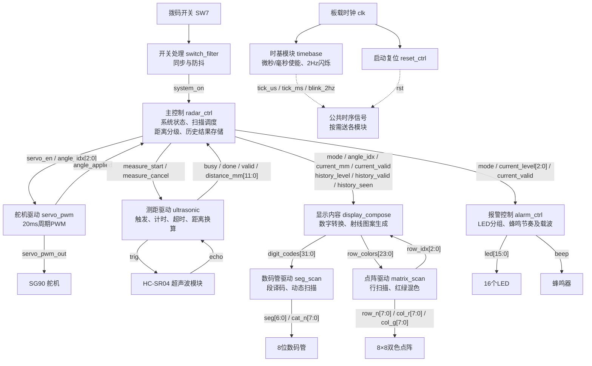
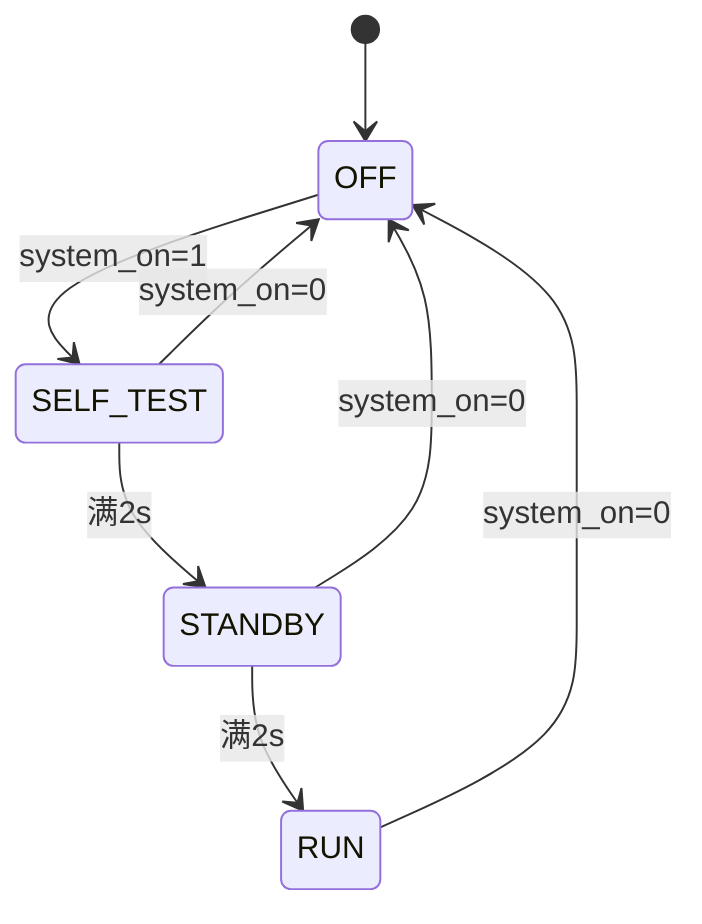

# 简易雷达报警系统初步设计方案

## 一、设计目标

采用模块化设计方法，以 MAX II CPLD 实验板为控制核心，结合 HC-SR04 超声波测距模块与 SG90 舵机，实现五方向往返扫描、障碍物距离显示、方向分级显示及声光报警。

系统上电后由 SW7 控制启动，依次进行 2s 自检和 2s 待机，然后按 `0°→45°→90°→135°→180°→135°→90°→45°→0°` 循环扫描，每个方向占用 2s。数码管显示指令角度及毫米距离，双色点阵保存各方向最近一次测量的等级，LED 和蜂鸣器针对当前方向报警。

本方案覆盖题目基本要求，连续扫描和液晶雷达图列为提高功能。以下为拟实现设计，尚未完成电路综合和实物验证。

## 二、总体框图

图 1 按实际 RTL 模块划分，箭头表示信号传递方向；方框中的中文说明模块功能，英文为拟采用的模块名。



**图 1　简易雷达报警系统总体框图**

所有时序模块均使用同一个 `clk` 和统一复位 `rst`。时基模块输出单周期计时使能，不作为新的时钟。为便于阅读，框图不重复绘制每个模块的时钟、复位及关机使能线。`radar_top` 负责连接图中模块、约束引脚，并按各输出有效电平实现关机控制。

### 2.1 主要模块间信号

| 信号 | 位宽 | 来源 → 目的 | 含义 |
|---|---:|---|---|
| `system_on` | 1 | 开关处理 → 主控、输出使能 | 处理后的系统开关 |
| `tick_us` / `tick_ms` | 各1 | 时基 → 相关模块 | 每微秒/毫秒一个周期的使能 |
| `blink_2hz` | 1 | 时基 → 显示、报警 | 亮250ms、灭250ms的闪烁信号 |
| `mode` | 2 | 主控 → 显示、报警 | 关机、自检、待机、运行 |
| `angle_idx` | 3 | 主控 → 舵机、显示 | 0～4代表五个扫描方向 |
| `servo_en` | 1 | 主控 → 舵机 | 舵机控制脉冲使能 |
| `angle_applied` | 1 | 舵机 → 主控 | 新角度已在PWM帧起点采用 |
| `measure_start` / `measure_cancel` | 各1 | 主控 → 测距 | 启动或取消本次测量 |
| `busy` / `done` / `valid` | 各1 | 测距 → 主控 | 测量忙、完成、结果有效 |
| `distance_mm` | 12 | 测距 → 主控 | 测量距离，单位mm |
| `current_mm` / `current_valid` | 12 / 1 | 主控 → 显示 | 当前方向已提交的距离及有效性 |
| `current_level` | 3 | 主控 → 报警 | 当前有效距离的等级0～4 |
| `history_level` | 15 | 主控 → 显示 | 五方向等级，每方向3位 |
| `history_valid` / `history_seen` | 各5 | 主控 → 显示 | 各方向结果有效位、是否已测量 |
| `digit_codes` | 32 | 显示 → 数码管驱动 | 8个4位显示字符编码 |
| `row_idx` | 3 | 点阵驱动 → 显示 | 请求生成的点阵行号 |
| `row_colors` | 24 | 显示 → 点阵驱动 | 当前行8个像素的3位颜色编码 |

`start`、`cancel`、`done`、`angle_applied` 均为一个主时钟周期的脉冲。`done` 有效时，主控锁存 `valid` 和 `distance_mm`。基础版同一时刻只有一项测量在途，`sample_idx` 在主控内部保存其所属方向。

## 三、主要模块详细设计

### 3.1 时基、复位与开关处理模块

**功能：** 为系统提供可靠启动、稳定开关输入和统一时间基准。

`timebase` 接收 `clk`、`rst`，通过计数器产生 `tick_us`、`tick_ms` 和 `blink_2hz`。主时钟频率由参数 `CLK_HZ` 指定，必须与实验板实际选择一致。若使用整数微秒分频，所选频率应为不小于1MHz的整MHz频率；否则重新设计计时分频，不能直接截断分频系数。

`switch_filter` 对 SW7 两级同步，再以毫秒使能检测输入稳定性，稳定时间初值取10ms。输出 `system_on` 控制系统状态和外设使能。

`reset_ctrl` 依据目标器件及综合工具支持的寄存器上电初始化方式生成启动复位，具体方式在工程建立时验证。SW7关闭进入关机态并清理业务计数器；全局复位与系统开关分别处理。

### 3.2 主控制模块 `radar_ctrl`

**功能：** 统一管理系统状态、扫描方向、测量调度、距离等级和历史结果。

**输入：** `clk`、`rst`、`system_on`、`tick_ms`、`angle_applied`、`busy`、`done`、`valid`、`distance_mm`。

**输出：** `mode`、`servo_en`、`angle_idx`、`measure_start`、`measure_cancel`、当前距离及等级、五方向历史数据。

#### （1）系统状态机



| 状态 | 显示与控制行为 |
|---|---|
| `OFF` | 关闭显示、LED、蜂鸣器、TRIG和舵机PWM，清除未完成测量 |
| `SELF_TEST` | 点阵全黄、数码管全8、16个LED同步2Hz闪烁，持续2s |
| `STANDBY` | 点阵显示题目图2-1；角度000、距离----、DISP4空白；舵机回0°，持续2s |
| `RUN` | 循环扫描，更新距离、方向历史和声光报警 |

#### （2）扫描调度

```text
设置目标方向 → 等待PWM采用新指令 → 等待稳定300ms
    → 启动测量 → 等待测量完成 → 提交结果
    → 等待当前2s时隙结束 → 切换下一方向
```

每个方向的2s从设置方向开始计时，包括PWM生效、稳定等待和测量时间。首次进入运行时0°已在待机期间生效，直接进入稳定等待，不等待新的角度变化事件。

方向索引为 `0→1→2→3→4→3→2→1→0`。用3位索引和1位往返标志实现，端点不额外重复。测量开始时锁存 `sample_idx`，完成后仅修改该索引对应的历史记录。

换向时将 `current_valid` 清零，显示 `----`，暂时关闭当前报警，但保持历史图案。正常回波测量有超时保护；若仍异常占用到2s时隙末尾，取消本次测量、记录无效并继续扫描。

#### （3）分级及历史寄存器

有效结果按800、600、400、200mm依次比较，产生0～4级，比较规则只在本模块定义一次。保存五组3位等级、五个有效位和五个已测量位。

- 尚未测量：保留待机绿色射线。
- 已测量且有效：显示对应等级颜色。
- 已测量但无效：该射线熄灭。

这样可以区分“尚未测量”和“本次无回波”，并保持其他方向的历史结果。

### 3.3 舵机驱动模块 `servo_pwm`

**输入：** `clk`、`rst`、`tick_us`、`servo_en`、`angle_idx[2:0]`。

**输出：** `servo_pwm_out`、`angle_applied`。

采用0～19999的微秒帧计数器产生20ms周期。在帧起点锁存目标角度并查表取得脉宽；计数值小于脉宽时输出高电平，否则输出低电平。

| 方向索引 | 指令角度 | 高电平宽度 |
|---:|---:|---:|
| 0 | 0° | 500μs |
| 1 | 45° | 1000μs |
| 2 | 90° | 1500μs |
| 3 | 135° | 2000μs |
| 4 | 180° | 2500μs |

首次启用或新角度在帧起点生效时产生 `angle_applied`，主控以此作为稳定等待起点。禁用时输出低电平并清帧状态，再启用从完整帧开始。舵机无位置反馈，数码管显示指令角度，实际安装角度需调试校准。

### 3.4 超声波测距模块 `ultrasonic`

**输入：** `clk`、`rst`、`tick_us`、`measure_start`、`measure_cancel`、`echo`。

**输出：** `trig`、`busy`、`done`、`valid`、`distance_mm[11:0]`。

```text
IDLE → TRIG → WAIT_RISE → COUNT_HIGH → CONVERT → DONE → IDLE
                 └────超时────┘          
取消请求：从任意工作状态返回IDLE，不提交旧结果
```

1. 空闲且ECHO为低时接受请求，输出15μs触发脉冲。
2. ECHO经两级同步后检测上升沿，启动高电平宽度计数。
3. 检测下降沿后保存时间，进行距离换算。
4. 从触发结束起设置约30ms总回波预算，无回波或高电平不结束均输出一次 `done`，同时 `valid=0`。
5. 请求到来时ECHO已高，按异常结果结束，不把旧高电平作为本次回波。

按照题目给出的340m/s声速，若回波时间为 `t_us`：

```text
distance_mm = round(0.17 × t_us)
            = (17 × t_us + 50) / 100   // 整数运算
```

20～4000mm范围的有效性由原始计时判断；在1μs计数精度下，可使用 `2000 ≤ 17×t_us ≤ 400000` 判定。结果为12位，中间运算至少19位，避免乘法截断。先评估常数运算综合开销，必要时采用分拍换算。

`done` 对每个正常结束或异常结束的请求只产生一次；取消请求不产生可提交结果。毫米是显示单位，不代表传感器具有1mm测量精度。

### 3.5 显示内容模块 `display_compose`

**输入：** `mode`、`blink_2hz`、`angle_idx`、`current_mm`、`current_valid`、五方向历史数据、`row_idx`，以及公共时钟和复位。

**输出：** `digit_codes[31:0]`、`row_colors[23:0]`。

数码管按 `DISP7～5：角度；DISP4：空白；DISP3～0：距离` 排列。角度查表生成000、045、090、135、180。距离在更新时转换成四位十进制，可采用12轮移位加3的二进制转BCD方法，转换完成后整体提交数字编码；转换期间及结果无效时显示横线。

字符编码约定为0～9表示数字，A表示横线，B表示空白，其余编码按空白处理。自检时全部为8，并由 `blink_2hz` 控制亮灭。

点阵以左上角为第0行第0列，按题目图2-1建立以下方向掩码，中心为第4行第3列：

| 方向 | 除中心以外的像素坐标（行，列） |
|---|---|
| 0° | (4,4)、(4,5)、(4,6) |
| 45° | (3,4)、(2,5)、(1,6) |
| 90° | (3,3)、(2,3)、(1,3)、(0,3) |
| 135° | (3,2)、(2,1)、(1,0) |
| 180° | (4,2)、(4,1)、(4,0) |

中心像素在待机和运行时固定绿色，避免五方向颜色争用。自检覆盖为全黄，关机覆盖为全灭。根据当前 `row_idx` 生成该行8个颜色编码，不设置整屏帧缓存。

### 3.6 数码管驱动模块 `seg_scan`

**输入：** `clk`、`rst`、扫描计时使能、显示使能、`digit_codes[31:0]`。

**输出：** `seg[6:0]`、`cat_n[7:0]`。

采用3位位扫描计数器，依次选通8个数码管。每位时隙初值取1ms，整轮约8ms。切换流程为关闭所有位选、更新段码、开启目标位，消隐时间计入位时隙。字符查表转换成a～g段码，段高有效、位选低有效。

模块不输出AP。51脚由舵机独占驱动；由于其与小数点电气复用，实际显示时可能出现小数点亮光，需要在上板时核验。

### 3.7 点阵驱动模块 `matrix_scan`

**输入：** `clk`、`rst`、`tick_us`、显示使能、`row_colors[23:0]`。

**输出：** `row_idx[2:0]`、`row_n[7:0]`、`col_r[7:0]`、`col_g[7:0]`。

每次只选通一行。切行时先关闭所有行，切换行号并等待颜色编码稳定，锁存该行颜色后再开始混色输出。每行设4个混色子周期，初值每个100μs；整屏约3.2ms加消隐时间。

| 颜色编码 | 颜色 | 四子周期中红/绿点亮次数初值 |
|---:|---|---|
| 0 | 熄灭 | 0 / 0 |
| 1 | 绿色 | 0 / 4 |
| 2 | 黄绿色 | 1 / 3 |
| 3 | 黄色 | 2 / 2 |
| 4 | 橙色 | 3 / 1 |
| 5 | 红色 | 4 / 0 |

每行均完整经历4个子周期，之后才切换下一行，避免行号与混色相位相关而产生偏色。红绿亮度比例在实物上调节。

### 3.8 声光报警模块 `alarm_ctrl`

**输入：** `clk`、`rst`、`tick_us`、`tick_ms`、`blink_2hz`、`mode`、`current_level`、`current_valid`。

**输出：** `led[15:0]`、`beep`。

| 等级 | 有效距离 | 点阵颜色 | LED行为 | 蜂鸣节奏设计值 |
|---:|---|---|---|---|
| 0 | ≥800mm | 绿色 | 4个蓝灯常亮 | 静音 |
| 1 | 600～799mm | 黄绿色 | 4个绿灯2Hz闪烁 | 每1000ms鸣叫50ms |
| 2 | 400～599mm | 黄色 | 4个黄灯2Hz闪烁 | 每500ms鸣叫50ms |
| 3 | 200～399mm | 橙色 | 4个红灯2Hz闪烁 | 每250ms鸣叫50ms |
| 4 | ＜200mm | 红色 | 16个灯2Hz闪烁 | 每125ms鸣叫50ms |

用约2kHz方波作为蜂鸣载波，鸣叫窗口控制其通断。LED闪烁与蜂鸣节奏分别计时。自检模式覆盖为全部LED闪烁；待机、关机或当前结果无效时关闭报警。LED颜色与位编号的映射按实物确认后写为常量掩码。

## 四、硬件接口与主要参数

| 对象 | CPLD引脚 | 说明 |
|---|---:|---|
| 系统时钟 | 18 | 参数与板上选择一致 |
| SW7 | 125 | 同步、防抖后使用 |
| 超声波TRIG | 94 | 触发输出 |
| 超声波ECHO | 95 | 回波输入，先同步 |
| 舵机PWM | 51 | 与数码管AP复用 |
| 蜂鸣器 | 60 | 输出音频方波 |

数码管、点阵和LED其余引脚按实验板说明书写入QSF，不在多个模块中重复驱动。题目指定超声波接3.3V、舵机接5V，接线前核对实际发放模块版本及回波电平，并确保共地。

| 参数 | 初值 | 性质 |
|---|---:|---|
| 自检时间 | 2000ms | 题目要求 |
| 待机时间 | 2000ms | 题目要求 |
| 方向时隙 | 2000ms | 题目要求 |
| LED/自检闪烁 | 2Hz | 题目要求 |
| 舵机PWM周期 | 20000μs | 题目给定 |
| 舵机稳定等待 | 300ms | 设计初值，实测调整 |
| 测距触发宽度 | 15μs | 设计值，满足题目大于10μs |
| 回波总超时 | 30ms | 设计值 |

## 五、未规定行为与验证计划

题目未明确无回波时点阵和报警的表现，本方案约定距离为 `----`、该方向射线熄灭、当前声光报警关闭；无回波不解释为已确认安全。低于模块最小范围的测量同样标记无效。中心像素固定绿色属于射线交点处理约定。

关机时关闭舵机控制脉冲，实物是否满足停止转动要求需验证；无控制脉冲不代表机械制动。基础版不使用液晶显示，运行和关机期间保持液晶显示关闭；工程建立时依据LCM12864手册确定初始化、显示关闭指令或复位控制，不能仅让接口悬空。

实施顺序为：基础时序与显示 → 舵机驱动 → 独立测距 → 扫描与历史结果 → 自检及报警 → 整机验证。

验证重点包括：

1. 2Hz亮灭周期、自检2s、待机2s和扫描2s时隙符合要求。
2. 五种舵机脉宽正确，目标更新仅在PWM帧边界生效。
3. 正常回波、无回波、ECHO持续高及超量程均能正确结束测量。
4. 距离199/200、399/400、599/600、799/800mm分档正确。
5. 历史颜色只更新本次方向，换向期间不显示上一方向距离。
6. 任何状态关闭SW7都能清理未完成事务，重新开启重新自检。
7. 数码管切位无明显重影，点阵五色可分辨，AP复用不破坏舵机波形。
8. 综合资源可容纳，主时钟时序满足要求，无多驱动和意外锁存器。

## 六、提高功能规划

基础要求稳定后，将五方向索引扩展为角度数值，以小步长、固定时间间隔更新舵机目标，实现近似匀速往返扫描。增加液晶驱动与雷达图生成模块，显示半圆刻度、扫描线和障碍物位置。触发测距时保存对应角度，避免运动过程中的结果与角度错配。

液晶初始化和寻址依据本目录LCM12864手册设计，采用查表和按字节生成图形，结合综合结果决定缓存结构。连续运动中的方向误差需单独测试。

## 七、设计依据

- 《2026秋季学期数字电路与逻辑设计实验（下）实验题目.pdf》，题目2，第4～7页。
- 《MAXII数字实验板（LCM12864液晶版）.pdf》，时钟、显示器件、蜂鸣器、开关及接口说明。
- 《LCM12864_14图形点阵液晶数据手册.pdf》用于后续确定液晶关闭及提高功能接口，相关时序尚待专项设计。

本文总体框图使用Mermaid语法。提交或导出时需使用支持Mermaid渲染的Markdown编辑器，确认图1和状态图以图形显示。
